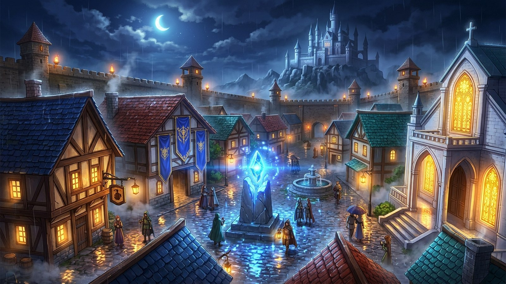

# Ashes of Alvor



A browser-based 3D fantasy RPG where every conversation is improvised by a language model,
while the game state stays authoritative on the server. You wake up in a walled frontier town
(*Cinzas de Alvor*), team up with Luna, a cartographer, and meet ten named NPCs. Each one has
their own persona, daily schedule and memory of you.

> The in-game text, NPC dialogue and narrator prompt are in **Brazilian Portuguese**. That is
> intentional: the game is written for a Portuguese-speaking audience. Code, docs and commits
> are in English, or are being migrated to it.

## What is interesting here

- **The LLM narrates, the server decides.** Quests, inventory, combat rewards, deaths and
  respawns live in `jogo.py` (`EstadoJogo`). An item pickup or a delivery is processed
  *before* the narrator is called and is injected into the prompt as a game fact, so the model
  cannot invent loot or skip a quest step.
- **Streaming with hidden state.** The narrator streams over SSE and appends a short
  `<estado>{...}</estado>` block (mood, intent, relationship deltas, new facts). A stream filter
  hides that block in real time. The server parses it, clamps the relationship to ±0.05 per
  turn (a slow burn), and persists it, with a heuristic fallback when a small model leaves the
  tag out.
- **Per-turn model routing.** A cheap model handles small talk. Puzzles, deductions across
  quests and long messages are routed to a stronger one, unless the player forces a model or
  effort level (`play.escolher_modelo`, covered by `test_roteamento.py`).
- **Crash-safe saves.** Atomic writes with a preserved copy of any unreadable save, plus
  versioned migrations of the save format (`test_save_atomico.py`, `test_jogo_v2.py`).
- **A city built from data, not by hand.** `tools/build_city.py` assembles the town (walls,
  houses, castle, market and forest) from CC0 kits, using zone scripts in `tools/zones/`.
  The client then fakes the shop interiors behind the windows with *interior mapping*.
- **Audio driven by one JSON file.** `public/data/sfx.json` drives 54 generated sound effects
  (100 files with variants), ambient beds mixed by zone, time, weather and NPC occupancy, and
  positional emitters through Web Audio `PannerNode`s.
- **A localhost-only server.** Writes, reads and resets coming from another origin are
  refused, and so is a forged `Host` header (`test_server_security.py`).

Content: 10 NPCs plus background extras, 14 quests, 14 collectibles, 29 items and 6 enemy types.

## Stack

- **Client:** Three.js 0.165 (ES modules from a CDN, no build step), plain JavaScript modules
  in `public/js/`.
- **Server:** Python 3.11+, standard library only (`http.server` plus SSE).
- **LLM:** Gemini through the `agy` CLI by default, or a local model through LM Studio
  (`--motor lmstudio`), or an offline stub (`--motor teste`) that exercises the full loop
  without calling any model.
- **Tooling:** `numpy` and `pillow`, needed only to rebuild the city and textures.

## Running it

```bat
Start-Game3D.bat
```

The script builds `public/assets/city/city.json` if it is missing, starts `server.py` on
`http://localhost:8000` and opens the browser. You can also start the server by hand:

```bat
python server.py               :: default engine (agy / Gemini)
python server.py --motor teste :: no model, deterministic narrator
```

There is also a text-only mode, the project's original prototype:
`Play-Luna.bat` / `python play.py`. `Start-Roleplay.bat` starts the PowerShell launcher
for LM Studio.

Before the first session you can describe your character in `historias/Isekai/jogador.txt`.
Save files (`relacao.json`, `historico.json`, `memoria.txt`, session logs) are created on
first run and are git-ignored.

## Tests

Each test is a standalone script and carries its own negative control: it reintroduces the
defect and checks that the test fails.

```bat
for %f in (test_*.py) do python %f
```

| Script | What it checks |
|---|---|
| `test_city.py` | the city the game actually loads: NPC routes clear of colliders, every quest spot reachable on foot (grid search), terrain height as the GPU draws it, enemy spawns |
| `test_combate.py` | server-authoritative combat, hunting contracts, death, save migration |
| `test_conversa.py` | per-NPC conversation isolation and migration of the old format |
| `test_detail.py` | detail-texture classes decode the same way the shader does, and layers tile without seams |
| `test_jogo_v2.py` | game state v2 end to end, including migration from a v1 save |
| `test_roteamento.py` | model routing and explicit overrides |
| `test_save_atomico.py` | a save survives a crash mid-write |
| `test_server_live.py` | a full quest loop against the running server |
| `test_server_security.py` | cross-origin and forged-Host requests are refused |
| `test_sfx.py` | sound references, loudness, seamless loops and footsteps |

## Layout

```
server.py        HTTP + SSE backend, prompt assembly, state parsing
jogo.py          authoritative game state (quests, inventory, combat)
play.py          narrator engine shared by the terminal and the 3D client
NARRATOR.md      narrator rules (runtime system prompt; the model answers in pt-BR)
historias/       world setting, opening scene, player sheet (pt-BR)
public/          the 3D client, game data (JSON), art and audio
tools/           city builder, zone scripts, art/texture/SFX generators
assets_src/      original asset packs and raw generated media
```

## Credits and licences

The code is released under the [MIT licence](LICENSE). The assets keep their own licences, see
[CREDITS.md](CREDITS.md). The 3D models are CC0. The sound effects were generated with
ElevenLabs on its free plan, which allows **non-commercial use only, with attribution**.
